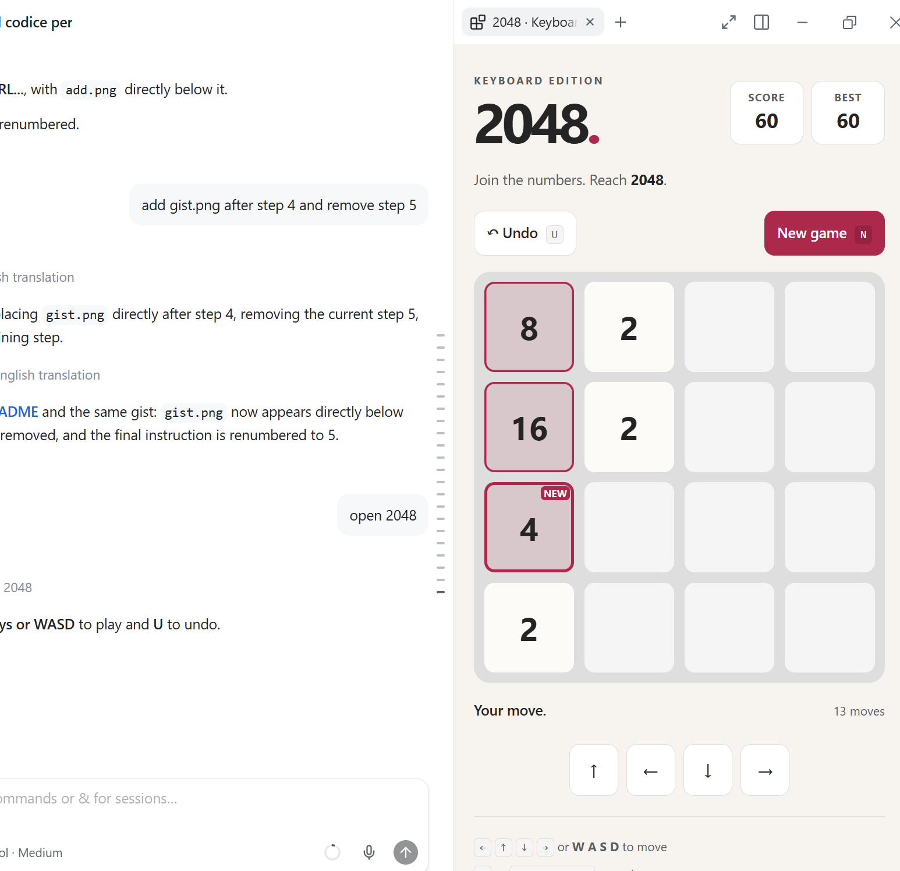
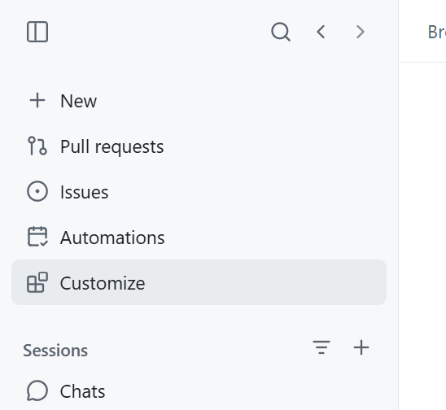
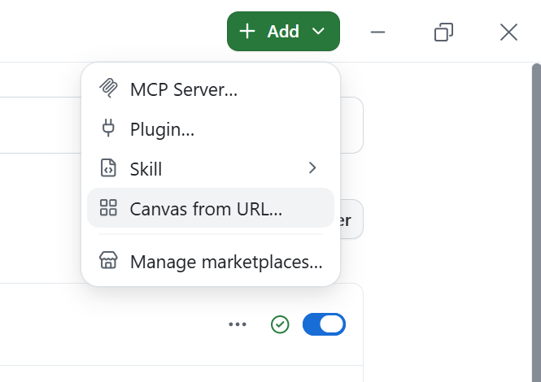
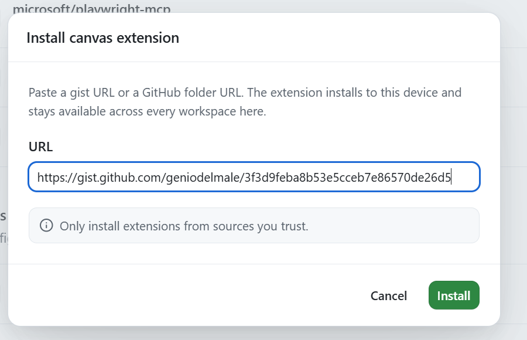

# 2048 Canvas for GitHub Copilot Desktop

## Introduction

A Canvas extension for GitHub Copilot Desktop with no external dependencies, featuring a 4 x 4 board,
2048 rules, keyboard shortcuts, on-screen controls, and swipe gestures.
Reaching 2048 does not end the game.



When no moves remain, a large **GAME OVER!** message appears over the tiles.
Undo or a new game removes the message as soon as the game is playable again;
the controls always remain accessible.

Tiles slide in their actual direction for 120 ms, followed by a subtle
100 ms pulse on merged tiles. New input immediately replaces any unfinished
animation; gameplay never waits for animations. Reduced motion disables
slides and merge pulses. Animation data is temporary and is not saved.
Each valid move still spawns a tile in a uniformly random empty cell:
90% chance of a 2 and 10% chance of a 4, independent of movement direction.
After updating an already-running extension, reload the extension provider
(or open a new chat) and reopen the canvas to enable movement tracking.

The tile spawned after each valid move has a highlighted border, a **NEW**
badge, and a brief animation. The indicator stays until the next valid move,
even after reloading the canvas. Undo and a new game clear it.
Moved or merged tiles do not receive this highlight.
Older saves remain compatible; the indicator will appear after the first
new move. With reduced motion enabled, the border and badge remain visible
without animation.

## Quick install from URL

Install using the [2048 extension gist](https://gist.github.com/geniodelmale/3f3d9feba8b53e5cceb7e86570de26d5):

1. Open Customize in GitHub Copilot Desktop

   

2. Press Add
3. Select Canvas from URL...

   

4. Paste `https://gist.github.com/geniodelmale/3f3d9feba8b53e5cceb7e86570de26d5`.

   

5. After installation, in the Chat ask: **Open the keyboard-2048 canvas** or simply **Open 2048**.

## Controls

| Control | Action |
|---|---|
| Arrow keys or WASD | Move the tiles |
| U or Ctrl+Z / Cmd+Z | Undo the last valid move |
| N | Request a new game, with confirmation |
| Directional buttons / swipe | Move without a keyboard |

Click the board to focus the canvas. Shortcuts work when focus is inside
the canvas, not in Copilot's chat input.

Undo has one level: it restores the exact board before the move, removes
the newly spawned random tile, and restores the score and move count.
A move with no effect does not consume Undo. You can also undo after
the game ends; the best score is not lowered. A new game clears Undo.

## Manual Installation

Copy this folder (without `\docs`) to `%USERPROFILE%\.copilot\extensions\keyboard-2048`
(or the `extensions` folder under `COPILOT_HOME`, if configured).
The entry point must remain `extension.mjs`.

Reload extensions from the runtime, if available, or open a new chat in
Copilot Desktop. Ask: **Open the keyboard-2048 canvas** or simply **Open 2048**.
No `npm install`, external server, or additional account is required:
Copilot resolves `@github/copilot-sdk/extension` automatically.

## Saving and architecture

Each conversation has a separate game, saved atomically to
`2048-save.json` inside `session.workspacePath`, provided by the SDK.
The score, conversation's best score, and Undo survive canvas reloads
and extension restarts. Two panels in the same conversation share state
and receive updates through Server-Sent Events.

The server uses only `127.0.0.1`, a system-assigned port, and a random
token for each panel. It does not send data to external services.
If a write fails, the move is not applied and the interface displays
the error. Corrupted saves are not overwritten: rename or recover them
before reopening the canvas.

`extension.mjs` registers the canvas and the `get_state`, `move`, `undo`,
and `new_game` actions. `game.mjs` contains the engine; `server.mjs` handles
saving, HTTP, and SSE; `index.html`, `style.css`, and `app.mjs` provide the UI.

## Local development

With Node.js 22 or later:

```powershell
node --test game.test.mjs server.test.mjs
node preview.mjs
```

The second command prints a local URL to try the interface without Copilot.
The preview uses a separate save in `artifacts\preview-save.json`.
Stop the server with Ctrl+C.
